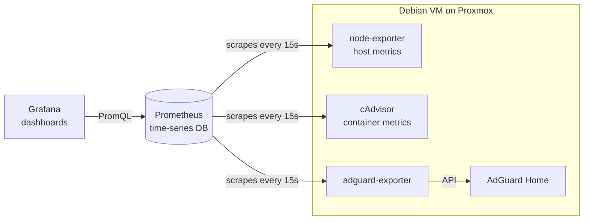

# Homelab Monitoring Stack

Metrics and dashboards for a Proxmox-hosted Docker homelab, built with Prometheus and Grafana and deployed with Docker Compose.

## Architecture



## Components

| Component | Purpose |
|---|---|
| Prometheus | Pulls metrics from each target every 15s and stores 30 days of history |
| Grafana | Visualization layer; each panel runs a PromQL query against Prometheus |
| node-exporter | Host-level CPU, memory, disk, and network |
| cAdvisor | Per-container CPU, memory, network, and disk I/O |
| adguard-exporter | DNS query counts, top clients, upstream response times, blocked queries |

## Design notes

- **Pull-based collection:** Prometheus scrapes targets, so a failed scrape immediately shows as a down target.
- **Exporter pattern:** apps without native Prometheus support get a small adapter that translates their API into the `/metrics` format.
- **Secrets** live in a `.env` file that is not committed. See `.env.example`.
- **Persistence:** Prometheus and Grafana data use named Docker volumes.

## Running it

```bash
cp .env.example .env   # fill in real values
docker compose up -d
```

- Prometheus: port 9090
- Grafana: port 3000

## Dashboards

_Screenshots coming soon._

## Roadmap

- [ ] Alerting (disk space, container down, DNS down)
- [ ] Logs with Loki
- [ ] Data pipeline: ingest service data into a warehouse, model with dbt, orchestrate with Dagster or Airflow
- [ ] Provision infrastructure with Terraform; migrate to k3s with GitOps
