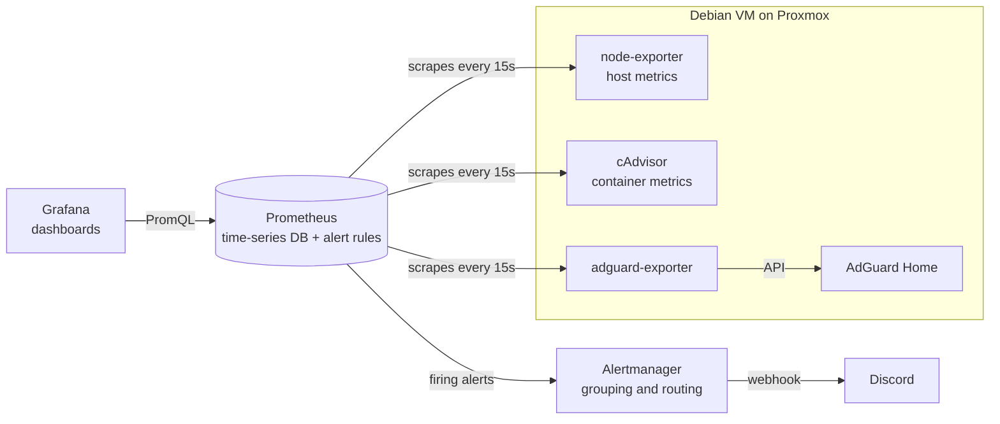

# Homelab Monitoring Stack

Metrics, dashboards, and alerting for a Proxmox-hosted Docker homelab, built with Prometheus, Grafana, and Alertmanager and deployed with Docker Compose.

## Architecture



## Components

| Component | Purpose |
|---|---|
| Prometheus | Pulls metrics from each target every 15s, stores 30 days of history, and evaluates alert rules |
| Grafana | Visualization layer; each panel runs a PromQL query against Prometheus |
| Alertmanager | Groups, deduplicates, and routes alerts to Discord, including resolved notifications |
| node-exporter | Host-level CPU, memory, disk, and network |
| cAdvisor | Per-container CPU, memory, network, and disk I/O |
| adguard-exporter | DNS query counts, top clients, upstream response times, blocked queries |

## Alerting

Rules live in `prometheus/rules/alerts.yaml`:

| Alert | Condition | Why |
|---|---|---|
| `TargetDown` | Any scrape target unreachable for 2 minutes | Covers every exporter, so a dead service or exporter is caught |
| `DiskWillFillIn24h` | `predict_linear` over the last 6h projects free space below zero within 24h | Warns before the disk is full, not after |

Alertmanager batches alerts by name and re-notifies every 4 hours while an alert stays active, which keeps noise down. The Discord webhook URL is read from a gitignored file rather than the config.

## Design notes

- **Pull-based collection:** Prometheus scrapes targets, so a failed scrape immediately shows as a down target.
- **Exporter pattern:** apps without native Prometheus support get a small adapter that translates their API into the `/metrics` format.
- **Alerting as code:** rules and routing are plain YAML in this repo, validated with `promtool check rules`.
- **Secrets** are kept out of Git: credentials in `.env` (see `.env.example`) and the Discord webhook in `alertmanager/discord_webhook`.
- **Persistence:** Prometheus, Grafana, and Alertmanager data use named Docker volumes.

## Running it

```bash
cp .env.example .env                              # fill in real values
printf '%s' 'YOUR-DISCORD-WEBHOOK-URL' > alertmanager/discord_webhook
docker compose up -d
```

- Prometheus: port 9090
- Grafana: port 3000
- Alertmanager: port 9093

Validate alert rules after editing them:

```bash
docker exec prometheus promtool check rules /etc/prometheus/rules/alerts.yaml
```

## Dashboards

_Screenshots coming soon._

## Roadmap

- [x] Metrics: host, containers, DNS
- [x] Alerting with Discord notifications
- [ ] Logs with Loki
- [ ] Dashboards provisioned as code
